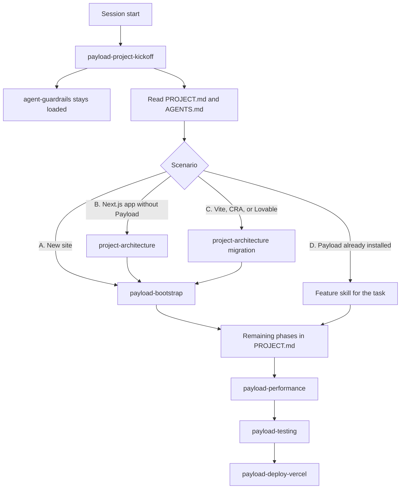

# Architecture

This repository is a library of [Agent Skills](https://agentskills.io) for Payload CMS 3 and Next.js. A skill is a folder with a `SKILL.md` file. The host agent reads the skill's name and description, then loads the body only when the task matches. Reference files load when a step points at them.

Install steps are in [INSTALL.md](INSTALL.md). Planned work is in [ROADMAP.md](ROADMAP.md). Pinned package versions and the drift check are in [VERSIONS.md](VERSIONS.md).

## Design goals

- **Load on demand.** Each skill covers one job. A session loads `payload-project-kickoff`, `agent-guardrails`, and the skill for the current phase.
- **One recommended path.** A decision has a single default. Alternatives sit in a table or a reference file. [CONTRIBUTING.md](../CONTRIBUTING.md) is the writing contract.
- **Snippets match pinned versions.** Code in a skill is valid for the versions in [versions.json](../versions.json). A newer API requires a `versions.json` update in the same change.
- **Guardrails on every session.** `agent-guardrails` blocks work outside the current phase, throwaway scripts, retry loops, secrets in logs, and destructive database commands.
- **Free tier first.** The default stack is Vercel Hobby, Turso through `@payloadcms/db-sqlite`, Cloudinary or Cloudflare R2, Mux (or Vimeo or unlisted YouTube), Resend (or Mailgun), Google APIs, Tailwind CSS, TanStack Query, React Hook Form with Zod, and next-intl. When a free-tier limit changes the design, the skill states the limit.

## How a session runs

`payload-project-kickoff` is the entry point. It loads `agent-guardrails` for the whole session, reads `PROJECT.md` and `AGENTS.md`, detects the scenario from the folder and `package.json`, writes a phased plan, and names the skill for the current phase. Role splits across models are in [model-roles.md](../skills/payload-project-kickoff/references/model-roles.md).



`project-architecture` owns the folder layout. When the frontend was built elsewhere, that skill refactors to the standard layout with no visual change before any Payload work. `payload-bootstrap` then creates the project from the official website template, or adds Payload to the existing Next.js app. It does not scaffold a Payload app by hand.

The kickoff skill keeps only the phases the brief needs, in this order. The same list is in the repository README.

When the brief includes a Figma URL, Design handoff (`figma-handoff`) comes before phase 1. When the design needs motion, 3D, or a copied component, Creative frontend (`creative-frontend`) comes after handoff and before bootstrap. Every phase below already has its skill in this repository. Payload 4 is the remaining library work and is not one of these phases.

1. Architecture (`project-architecture`)
2. Bootstrap and data model (`payload-bootstrap`)
3. Admin: roles, branding, languages (`payload-auth-rbac`, `payload-admin-branding`, `payload-localization`)
4. Content (`payload-live-preview`, `payload-media`, `payload-seo-geo`, `payload-legal-trust`)
5. Business flows (`payload-forms-crm`, `payload-bookings-payments`, `payload-integrations`, `payload-mcp`)
6. Performance (`payload-performance`)
7. Testing (`payload-testing`)
8. Deploy (`payload-deploy-vercel`)

One phase at a time. Feature skills are the middle of that list: admin, content, and business flows. `payload-performance`, `payload-testing`, and `payload-deploy-vercel` are the quality skills and run after the feature phases the brief includes.

The routing table inside [payload-project-kickoff](../skills/payload-project-kickoff/SKILL.md) maps a task to a skill. Follow that table when the phase list is ambiguous.

## Official Payload skill

Payload publishes its own `payload` skill for the CMS API: collections, fields, hooks, access control, and queries. This library leaves that skill out of the repository. Projects install it beside these skills. These skills cover stack choices and end-to-end flows. The official skill covers API details. Read it instead of guessing field options or hook signatures.

On the 3.x line of `create-payload-app`, `--agent` downloads `tools/claude-plugin/skills/payload` from the `3.x` branch unless `--branch` is set. The accepted values are `claude`, `codex`, and `cursor`. `claude` writes `.claude/skills/payload` and `CLAUDE.md`. `codex` and `cursor` write `.agents/skills/payload` and `AGENTS.md`. `payload-bootstrap` runs this for a new site.

For an existing project, `payload-project-kickoff` installs the same skill with:

```bash
npx degit payloadcms/payload/tools/claude-plugin/skills/payload#3.x .agents/skills/payload
```

The `3.x` branch matches Payload 3. The default branch documents Payload 4. The kickoff skill treats the skill as installed when either `.agents/skills/payload/SKILL.md` or `.claude/skills/payload/SKILL.md` exists. Claude Code reads `.claude/skills/`, so a Claude Code project needs the folder there.

## Skill anatomy

```text
skills/<skill-name>/
  SKILL.md          frontmatter, steps, Stop and ask, Done when
  references/       detail loaded only when a step points at it
  assets/           files the agent copies into the project
```

`references/` is one directory deep. `SKILL.md` stays under 500 lines. Frontmatter carries `name` (equal to the folder name), `description`, `license`, and `metadata.version`.

A skill refers to another skill by name in backticks, for example `` `payload-media` ``. There is no relative link from one skill folder to another. Someone who installed a single skill can still follow the name. The validator checks those names against `skills/`.

## Project state

Generated projects keep two root files. The kickoff skill copies them from [PROJECT.template.md](../skills/payload-project-kickoff/assets/PROJECT.template.md) and [AGENTS.template.md](../skills/payload-project-kickoff/assets/AGENTS.template.md) when they are missing.

`PROJECT.md` is the session memory: client, brief, scenario, design, languages, features, accounts, phases, decisions, questions, blockers, and a session log (newest first). It also holds the invalidation map: one row per collection or global that has public routes, with paths, tags, and writes per save.

`AGENTS.md` tells every agent to start at `payload-project-kickoff`, follow `agent-guardrails`, and read `PROJECT.md`. `create-payload-app --agent` may write its own `AGENTS.md` or `CLAUDE.md` first. The bootstrap skill appends the template rules to that file.

## Quality gates

`npm run validate` runs [scripts/validate-skills.mjs](../scripts/validate-skills.mjs). It checks frontmatter, the name and folder match, description length, the 500-line limit, relative links, cross-skill name references, and English-only content. It needs Node.js 20 or later and has no dependencies. [Validate skills](../.github/workflows/validate.yml) runs the same script on every pull request and on pushes to `master`.

[Upstream drift](../.github/workflows/upstream-drift.yml) compares `versions.json` with the npm registry every Monday and opens an issue when a major or minor version moves. The procedure is in [VERSIONS.md](VERSIONS.md).

Cache invalidation is a cost. On Vercel, each revalidated path regenerates on the next visit and counts as an ISR write. Hobby has a monthly allowance; after it is spent, content stops updating. `payload-performance` designs the smallest set of paths and tags that is still correct: no tag shared by every query, and no layout-wide revalidation for ordinary content. The invalidation map in `PROJECT.md` is the review record. The rules and the helper live in [invalidation-design.md](../skills/payload-performance/references/invalidation-design.md).
